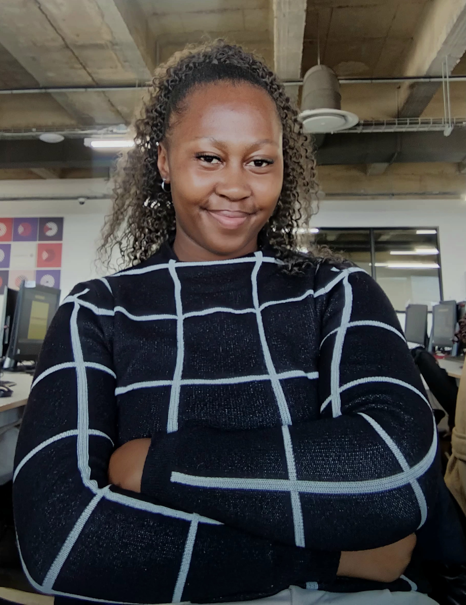

# Hi, I'm Joyce Sellwane Mosia

### Software Developer Intern | Johannesburg, South Africa

## About Me

I’m a Software Developer Intern based in Braamfontein, Johannesburg. I’m currently on the Capaciti End to End Technology Programme, and I graduated with an Advanced Diploma in ICT in Applications Development in May 2026.

I’m now looking for a placement where I can apply the skills I’ve built over the past 6 months of the programme, and keep growing in a real team and a real working environment.

I like building software that solves a real problem for the people using it. I work on a project from the first plan right through to getting it online and writing it up, so I understand every stage and not just the coding.

What I’m focusing on at the moment:

Kotlin and object-oriented programming
Spring Boot
Building full stack applications from start to finish
Connecting AI services (Groq, Anthropic, Ollama and LangChain) to real products
Database design and good engineering habits

My goal is to become a Full Stack Developer whose work people can rely on. I’m ready to bring my skills, my work ethic and my willingness to learn to a company that gives me the chance to contribute.

---

## Skills

**Languages:** Java, Python, Kotlin, JavaScript, SQL, VB.NET

**Frontend:** React, HTML, CSS

**Backend and databases:** Node.js, Spring Boot, MongoDB Atlas, MySQL

**Tools and platforms:** Git, GitHub, Docker, VS Code, Vercel, Render, Windows (WSL2)

---

## Projects

### OpenEx 3.0
**What it is:** A practice cryptocurrency exchange where people can buy and sell pretend coins using pretend money. It was my three week capstone project.

**How it works:** The backend keeps a precise record of every transaction, the same way an accountant records money going out of one account and into another, so the numbers always add up. It also matches buyers with sellers, giving priority to the best price first and the earliest order second. The website shows the live list of buy and sell orders, updating as things happen. I also built an AI assistant called Candle that people can chat to for help with trading questions.

**Built with:** Kotlin, Spring Boot, React, WebSockets, Python, LangChain, Ollama (Groq as a backup), Docker. Hosted on Render and Vercel.

[View on GitHub](https://github.com/sellwane7/openex3.git)

### CyberSage
**What it is:** A tool that helps South African municipalities make their spending and decisions more open and honest.

**Why we built it:** This was a group project that my team and I created for the Naspers Labs Tech Career Accelerator Challenge. It uses AI to help spot problems and keep records clear. Alongside the build, we put together a full pitch deck and a speaker script to present the idea.

**My part:** I worked with my team on the build, the pitch deck and the speaker script.

<!-- Add the CyberSage repository link here -->

### DeskFlow
**What it is:** An internal IT help desk for a company. When something goes wrong, such as a broken laptop or a login problem, an employee logs a request on the site. The IT team can then see it, work on it and update its progress.

**How it works:** Users have to sign in securely before they can see anything, so people only see what they are allowed to.

**Built with:** Node.js, Express, MongoDB, React and JWT login. Hosted on Render and Vercel.

[View on GitHub](https://github.com/sellwane7/deskflow.git)

### MineTrax AI
**What it is:** A safety tool for the mining industry. It helps mines look at their safety data, find patterns and risks, and stay in line with the Mine Health and Safety Act (MHSA).

**How it works:** It uses AI through the Groq service, along with machine learning methods that group similar incidents and predict likely problems. It can also turn the results into PDF or Word reports that are ready to share.

**Built with:** Python, Streamlit, Groq API.

[View on GitHub](https://github.com/sellwane7/Minetrax-ai.git)

### NexGen Studio
**What it is:** A simple website that writes content for you. You tell it what you need, and it uses AI to produce the text.

**Built with:** Plain HTML, CSS and JavaScript, using the Anthropic API.

[View on GitHub](https://github.com/sellwane7/content-generator.git)

### OceanIQ Chatbot
**What it is:** A chatbot that teaches people about life in the ocean and why sustainable fishing matters. You can ask it questions and get clear, easy answers.

[View on GitHub](https://github.com/sellwane7/OceanIQ-Chatbot.git)

### BizIntel AI
**What it is:** A business analytics platform. You upload a spreadsheet of your data, and it quickly gives you a clear picture of what the numbers are saying, so you don't need to dig through rows yourself.

**Built as:** A full stack application with AI-powered analysis.

[View on GitHub](https://github.com/sellwane7/bizintel_ai.git)

---

## Get In Touch

Johannesburg, South Africa

